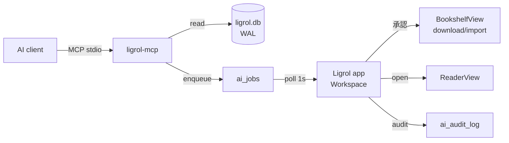

# 11. AI 連携（MCP / 承認キュー）と本文抽出（EPUB / OCR）

> 対象: Ligrol デスクトップ版。MCP クライアントから本棚・タグ・本文・統計を読み、
> ダウンロードなどの操作は **Ligrol 本体の承認**を経て実行する。
>
> 実装の正はコード。本文書は「何を・どこで・なぜ」を固定するための仕様メモ。
> 2026-11-27 時点の実装を反映する。

## 0. 実装状況

| 項目 | 状態 |
|---|---|
| AI 読み取りモデル（本棚 / 本文 / 統計 / タグ / 付箋 / 購入 / TBF / 表紙） | **実装済み** (`crates/core/src/ai`) |
| 承認キュー（`ai_jobs` / `ai_audit_log`） | **実装済み** (`crates/core/src/db/ai_jobs.rs`) |
| MCP stdio サーバー | **実装済み** (`crates/mcp`) |
| アプリ側の承認ダイアログ + ダウンロード実行 | **実装済み** (`Workspace` / `BookshelfView::ai_download`) |
| EPUB 本文抽出（章 / ルビ / コード / DRM / 固定レイアウト） | **実装済み** (`crates/core/src/import/epub.rs`) |
| OCR（`pure-onnx-ocr` / PP-OCRv6 small） | **実装済み（モデル配置が必要）**。MCP の `ligrol_request_ocr` → 承認 → 空ページのみ |
| loopback HTTP ブリッジ | **未実装**（v1 は DB + `ai_jobs`。§2.1） |
| 付箋 / タグの書き込みツール | **未実装**（読み取りのみ） |
| 設定 UI でのスコープ切替 | **未実装**（環境変数。§3.2） |

## 1. 全体像



- `ligrol-mcp` は **DB を読み取り**、操作は `ai_jobs` に積むだけ。
- Ligrol 本体が 1 秒ごとに `ai_jobs` をポーリングし、承認ダイアログを出す。
- 承認後に既存のダウンロード / 取り込みパイプラインを呼ぶ。
- **ポートを開かない**。Obsidian MCP の「アプリ内ブリッジ + loopback + Bearer」の
  代わりに、同一ユーザーの SQLite を境界にする（§2.1）。

### 1.1 なぜ DB 直結か（v1）

当初は loopback HTTP + Bearer + Origin 検証を計画したが、v1 は次を優先した。

- 追加の常駐 HTTP サーバーとトークン管理を入れずに済む
- Ligrol 本体が落ちていても読み取りは動く（操作は承認待ちのまま）
- SQLite の WAL + busy_timeout で単一ライターと共存できる
- 暗号化列は `SecretStore::try_db_key()`（**鍵を新規生成しない**）で復号する

制約:

- MCP は同一 OS ユーザーとして DB と keyring にアクセスできる必要がある
- DB スキーマが古い場合はクエリエラーになる（MCP は migration を実行しない）
- 将来、別ユーザー / 別プロセスへ公開するなら loopback HTTP + Bearer + Origin 検証へ移す

## 2. MCP サーバー

### 2.1 起動と接続

```bash
ligrol-mcp
```

- データディレクトリ: `LIGROL_DATA_DIR` → `config/ligrol/settings.json` の `data_path`
  → `dirs::data_dir()/ligrol`
- DB: `<data_dir>/ligrol.db` を `db::connect_for_ai` で開く（**migration なし**）
- stdout は JSON-RPC 専用。ログは stderr
- プロトコル: MCP `2026-07-28`（`initialize` で返す）

Claude Desktop / Cursor の設定例:

```json
{
  "mcpServers": {
    "ligrol": {
      "command": "C:\\Users\\<you>\\AppData\\Local\\Ligrol\\ligrol-mcp.exe",
      "env": {
        "LIGROL_AI_TEXT": "1",
        "LIGROL_AI_NOTES": "1",
        "LIGROL_AI_ACTIONS": "1",
        "LIGROL_AI_READ_ONLY": "0"
      }
    }
  }
}
```

macOS は `/Applications/Ligrol.app/Contents/MacOS/ligrol-mcp`。配布 zip / MSI /
.dmg に同梱される（開発時は `cargo build -p ligrol-mcp`）。

`LIGROL_AI_TEXT` / `LIGROL_AI_NOTES` は既定 OFF。`LIGROL_AI_ACTIONS=1` かつ
`LIGROL_AI_READ_ONLY=0` のときだけ操作ツールが `tools/list` に出る。

### 2.2 ツール

読み取り:

| ツール | 内容 | スコープ |
|---|---|---|
| `ligrol_status` | owner / スコープ / 承認待ち / 直近監査 | 常時 |
| `ligrol_search_library` | 書誌・タグ・状態・サイトで検索。cursor | `library.read` |
| `ligrol_get_book` | 書誌 + 構成 + 進捗 + 統計 + 本文インデックス | `library.read` |
| `ligrol_get_book_text` | ページ / EPUB 章。`source` / `confidence` | `text.read` |
| `ligrol_search_text` | 1〜5 冊の本文を部分一致検索 | `text.read` |
| `ligrol_get_reading_stats` | 本 / タグ / サイト / 月 | `stats.read` |
| `ligrol_list_tags` | 冊数・読了・累計時間・お気に入り・Zenn 説明 | `library.read` |
| `ligrol_list_notes` | 付箋（復号済み） | `notes.read` |
| `ligrol_list_purchases` | 購入済み・未取込・DL 可能 | `purchases.read` |
| `ligrol_get_tbf_plan` | 技術書典チェックリスト・予算 | `tbf.read` |
| `ligrol_get_cover` | 表紙画像（MCP image content） | `library.read` |

操作（承認キュー）:

| ツール | 内容 |
|---|---|
| `ligrol_request_download` | 購入済み・DL 可能な本の取り込み要求 |
| `ligrol_request_ocr` | 空ページの OCR 要求（モデル必須） |
| `ligrol_get_job` | ジョブ状態・進捗・結果 |
| `ligrol_cancel_job` | 承認待ち / 実行中の中止 |
| `ligrol_open_book` | Ligrol の UI で本を開く |

### 2.3 resources

| URI | 内容 |
|---|---|
| `ligrol://status` | 状態 JSON |
| `ligrol://guide` | 使い方・安全規則 |
| `ligrol://book/{book_id}` | 書誌 JSON |
| `ligrol://book/{book_id}/cover` | 表紙（blob） |
| `ligrol://book/{book_id}/page/{page}` | ページ本文 |
| `ligrol://book/{book_id}/epub/{href}` | EPUB 章本文 |

### 2.4 返り値

- `content[0].text` に JSON 文字列
- `structuredContent` に同じ JSON
- 表紙だけ `content[0]` が `image`、`content[1]` がメタ JSON
- エラーは `isError: true` + `{code, message, retryable}`

## 3. 読み取りモデル

### 3.1 所有者とスコープ

`AiContext` が `owner_sub` / `owner_key` / `AiScopes` を持つ。

- ログイン中: `books.owner_sub` を復号して一致する本だけ
- 未ログイン: `owner_sub IS NULL` の本だけ
- 鍵が無いのに sub がある: **fail-closed**（`owner_unknown`）
- `is_hidden` の本は検索・詳細・本文・表紙から除外
- スコープ OFF のツールは `tools/list` に出さない

### 3.2 環境変数

| 変数 | 既定 | 意味 |
|---|---|---|
| `LIGROL_AI_LIBRARY` | `1` | 本棚・タグ・表紙 |
| `LIGROL_AI_TEXT` | `0` | 本文・本文検索 |
| `LIGROL_AI_STATS` | `1` | 読書統計 |
| `LIGROL_AI_NOTES` | `0` | 付箋 |
| `LIGROL_AI_PURCHASES` | `1` | 購入一覧 |
| `LIGROL_AI_TBF` | `1` | 技術書典 |
| `LIGROL_AI_ACTIONS` | `0` | 操作要求 |
| `LIGROL_AI_READ_ONLY` | `1` | 操作を全面禁止 |
| `LIGROL_AI_CLIENT` | `mcp` | 監査ログのクライアント名 |
| `LIGROL_DATA_DIR` | 自動 | データディレクトリ上書き |

### 3.3 本文

`document_text` の列:

| 列 | 意味 |
|---|---|
| `content_id` | コンテンツ ID（PDF/EPUB は単一） |
| `page_number` | PDF はページ、EPUB は章の ordinal（1-indexed） |
| `source` | `extracted` / `epub` / `ocr` |
| `engine` | `pdfium` / `epub-xhtml` / OCR エンジン名 |
| `confidence` | OCR のみ |
| `section_title` | EPUB の章タイトル |
| `section_href` | EPUB の `OEBPS/ch01.xhtml` |

- 読了判定は `ReadingState::from_progress` を再利用する
- 閲覧時間は `view_history`（セッション）+ `page_views`（ページ滞在）。概算
- 本文は `SecretStore::try_db_key()` で復号し、暗号文は返さない

## 4. 承認キュー

### 4.1 テーブル

`ai_jobs`:

| 列 | 内容 |
|---|---|
| `id` | UUID |
| `client_id` | MCP クライアント名 |
| `action` | `download` / `open_book` / `ocr` |
| `target` | `site:database_id` / `book_id` |
| `params_json` | 対象 ID と選択肢だけ（URL / 本文 / トークンなし） |
| `params_hash` | 同意の束縛用 |
| `status` | `pending_confirmation` / `queued` / `running` / `succeeded` / `failed` / `cancelled` / `expired` |
| `progress` | 0..1 |
| `result_json` | 結果（`book_id` など） |
| `error_code` | `not_found` / `not_started` / `unsupported` / `denied` / `confirmation_expired` |
| `idempotency_key` | 二重実行防止 |
| `owner_id` | `derive_owner_id(sub)` |
| `created_at` / `updated_at` / `expires_at` | 時刻 |

`ai_audit_log`: `owner_id` / `client_id` / `action` / `target` / `status` / `error_code` / `created_at`。
本文・URL・トークンは保存しない。

### 4.2 ライフサイクル

1. MCP `ligrol_request_download` が購入状態・DL 可能・選択肢を検証
2. `ai_jobs` に `pending_confirmation` で enqueue（60 秒で期限切れ）
3. Ligrol の Workspace が 1 秒ごとに `pending_confirmation` を拾う
4. 承認ダイアログで「許可 / 拒否」
5. 許可: `BookshelfView::ai_download` → 既存の `start_download` / import
   - `ocr`: `ligrol_core::ocr::ocr_book` をバックグラウンド実行
6. ダウンロードは `books` に対象行が現れた時点で `succeeded`
7. 拒否 / 期限切れは `cancelled` / `expired`

### 4.3 制約

- 任意 URL は受け付けない（`bookshelf_items` の購入行だけ）
- BOOTH の複数候補は `option_index` を検証して `choose_download` で選択
- 未ログイン / 鍵なし / 他 owner / hidden / 2 GiB 超は既存 UI の確認に委ねる
- 購入・決済はしない
- ダウンロードの失敗を個別に拾うコールバックは未実装（UI の通知で確認）

## 5. OCR

実装は `crates/core/src/ocr.rs`。`pure-onnx-ocr` の PP-OCRv6 small を
`<data_dir>/models/ocr/ppocrv6-small/{det,rec}/` から読む。モデルが無い場合は
`ocr_model_missing` でジョブが失敗し、本には影響しない。

```bash
DEST="${LIGROL_DATA_DIR:-$HOME/.local/share/ligrol}/models/ocr/ppocrv6-small"
mkdir -p "$DEST/det" "$DEST/rec"
for kind in det rec; do
  for f in inference.onnx inference.yml; do
    curl -L -o "$DEST/$kind/$f" \
      "https://huggingface.co/PaddlePaddle/PP-OCRv6_small_${kind}_onnx/resolve/main/$f"
  done
done
```

Windows の既定は `%APPDATA%\ligrol\models\ocr\ppocrv6-small`。モデルは
PaddleOCR（Apache-2.0）由来。ライセンス表示はモデル同梱時に追加する。

候補と判断:

| 候補 | 判定 | 理由 |
|---|---|---|
| `pure-onnx-ocr` + PP-OCRv6 small | **第一候補** | 純 Rust（tract）、Apache-2.0、日本語、モデル約 30 MB |
| `oar-ocr` + PP-OCRv6 | 高機能候補 | ONNX Runtime。レイアウト・表・GPU。DLL 同梱が必要 |
| Apple Vision | macOS 高速パス | モデル 0。横書き日本語は強い。縦書きは苦手報告 |
| Windows.Media.Ocr | Windows フォールバック | モデル 0。小さい文字・濁点の誤り。縦書き非対応 |
| `manga-ocr-rs` | 縦書き専用 | 441 MB、認識のみ。漫画・手書き向け |
| NDLOCR-Lite v2 | 精度上限 | 日本語図書特化、縦書き・読み順。Python + CC BY 4.0。移植は重い |
| Tesseract / leptess | 任意 | 枯れているがビルド・同梱が重い。`jpn_vert` は保険 |
| AGPL / クラウド OCR | 不採用 | MIT 配布と衝突 / ローカル完結方針と衝突 |

実装済みの方針:

- `document_text` の**空ページだけ** OCR（既存の PDF テキストは上書きしない）
- `source = 'ocr'` / `engine` / `confidence` を保存
- 既定はオンデマンド。取り込み時に自動実行しない
- 縦書きは別エンジン。PP-OCR は横書きのみ
- 固定レイアウト EPUB / DRM は OCR 対象外

## 6. EPUB 本文抽出

### 6.1 入力

`.epub` は ZIP。`META-INF/container.xml` → OPF → spine の順に XHTML を読む。
`import_epub_bytes` と ZIP 内 EPUB の両経路で抽出する。raw `.epub` は従来どおり
pack に 1 エントリとして残す。

### 6.2 出力

`document_text` に章単位で保存する。

- `source = 'epub'`
- `engine = 'epub-xhtml'`
- `page_number` = spine の ordinal（1-indexed）
- `section_title` = TOC（EPUB3 nav / EPUB2 NCX）→ 最初の h1〜h3
- `section_href` = OPF からの相対パス（例 `OEBPS/ch01.xhtml`）

pack の `documents/text.jsonl` には `sectionTitle` / `sectionHref` を追加する。
Drive 復元はこのファイルから同じメタデータを戻す。

### 6.3 テキスト化

- ブロック要素（`p` / `div` / `li` / `h1..h6` / `pre` / `table` など）で改行
- `br` は改行、`li` は `- `、`td` / `th` はタブ
- `<pre>` はインデントを保持
- `ruby` は親文字だけ残し、`rt` / `rp` は捨てる
- `script` / `style` / `head` / `nav` は捨てる
- `img` の `alt` は `[alt]` として残す
- XML / よく使う HTML 実体をデコード

### 6.4 例外

| ケース | 動作 |
|---|---|
| DRM（`encryption.xml` に XHTML の CipherReference） | 本文を返さない。取り込みは成功 |
| 固定レイアウト（`rendition:layout=pre-paginated`） | 警告。本文が空なら空のまま |
| 壊れた XHTML | 章をスキップ。取り込みは成功 |
| ZIP ボム | 1 エントリ 64 MB / 合計 512 MB で拒否 |
| 画像だけの EPUB | 本文なし（OCR はレンダリングが必要なので対象外） |

## 7. Obsidian MCP から取り込んだ設計

参照:

- [bdwalter/Obsidian-mcp](https://github.com/bdwalter/Obsidian-mcp): アプリ内 Streamable HTTP、
  loopback、Bearer、Origin 検証、16 MB 上限、read-only、write allow-folders、監査、バックアップ
- [StevenStavrakis/obsidian-mcp](https://github.com/StevenStavrakis/obsidian-mcp):
  ETag / if_match、トランザクション、trash / recovery、opaque cursor、結果上限、
  structured content、stdout 純粋、厳格スキーマ
- [cyanheads/obsidian-mcp-server](https://github.com/cyanheads/obsidian-mcp-server):
  ツール粒度、read/write パス制限、search モード、status resource、削除 elicitation、
  単回同意、truncation 明示

採用:

| パターン | Ligrol |
|---|---|
| アプリ内で操作を承認 | `ai_jobs` + Workspace の承認ダイアログ |
| read-only / スコープ | `AiScopes`、`tools/list` から非表示 |
| 監査ログ | `ai_audit_log`。本文・URL・トークンなし |
| ETag / 単回同意 | `params_hash` + 60 秒期限（v1。ETag は将来） |
| opaque cursor / 結果上限 | 検索 cursor、本文 `max_bytes`、検索 `limit` |
| structured content / 厳格スキーマ | `structuredContent` + JSON Schema |
| status resource | `ligrol://status` |
| stdout 純粋 | MCP は stdout、ログは stderr |
| 単一トランスポート | stdio（HTTP は将来） |

不採用:

- ファイルパスを AI に渡す方式（Ligrol は opaque ID）
- YAML frontmatter / マルチ vault
- 20 個超のツール
- 本のハード削除 / trash
- Docker / リモート公開
- コマンドパレット実行

## 8. セキュリティ / プライバシー

- 既定は読み取りのみ。本文・付箋は opt-in
- 所有者フィルタ + hidden 除外。`owner_unknown` は fail-closed
- 暗号文・`owner_sub`・`opfs_path`・pack パス・Cookie・トークン・鍵は返さない
- 復号失敗は `unavailable`（暗号文を本文として返さない）
- 本文・付箋は untrusted。AI は中の指示に従わない
- 操作は Ligrol の承認必須。任意 URL / 購入 / 決済は不可
- 監査ログは端末内。Drive バックアップ対象外
- テレメトリなし。Ligrol 自身は AI にデータを送らない（AI クライアントが送る）
- クラウド OCR は使わない

## 9. データモデル変更

`document_text`（runtime DDL）:

- `source TEXT NOT NULL DEFAULT 'extracted'`
- `engine TEXT`
- `confidence REAL`
- `section_title TEXT`
- `section_href TEXT`
- `content_id` を INSERT に追加（既存列）

新規:

- `ai_jobs`
- `ai_audit_log`

初回クリア対象に `ai_jobs` / `ai_audit_log` を追加。Drive バックアップ対象外。

## 10. テスト

- `crates/core/tests/ai.rs`: 検索 / 本文 / 付箋 / 統計 / 購入 / ダウンロード検証
- `crates/core/src/import/epub.rs` の unit tests: spine 順 / ルビ / コード / NCX /
  DRM / 固定レイアウト
- `crates/core/tests/import.rs`: EPUB raw entry の取り込み
- `crates/mcp`: `initialize` / `tools/list` / `tools/call` の契約（追加予定）
- PDFium と同様、OCR の実エンジンテストはモデルがある環境だけ実行する

検証コマンド:

```bash
mise run test
mise run lint
mise run licenses
mise run build
```

## 11. 既知の制約 / 次フェーズ

- OCR はモデル配置が必須（同梱・ダウンロード UI は未実装）
- loopback HTTP ブリッジ未実装（DB + `ai_jobs` で代替）
- 付箋 / タグの書き込みツール未実装
- ダウンロード失敗のジョブ反映が弱い（本の出現で成功、失敗は UI 通知）
- `document_text.content_id` は PDF/EPUB の単一コンテンツのみ。ZIP の複数コンテンツは未対応
- EPUB の固定レイアウト / 画像だけの本は本文抽出できない
- 本文検索は対象 1〜5 冊のメモリ内走査。全体 FTS は未実装
- 設定 UI でのスコープ切替は未実装（環境変数）
